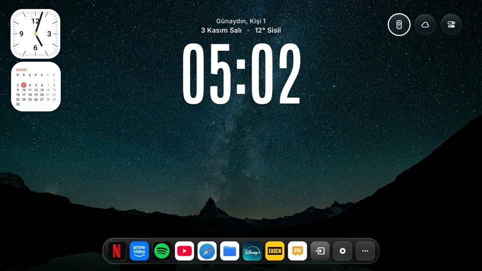
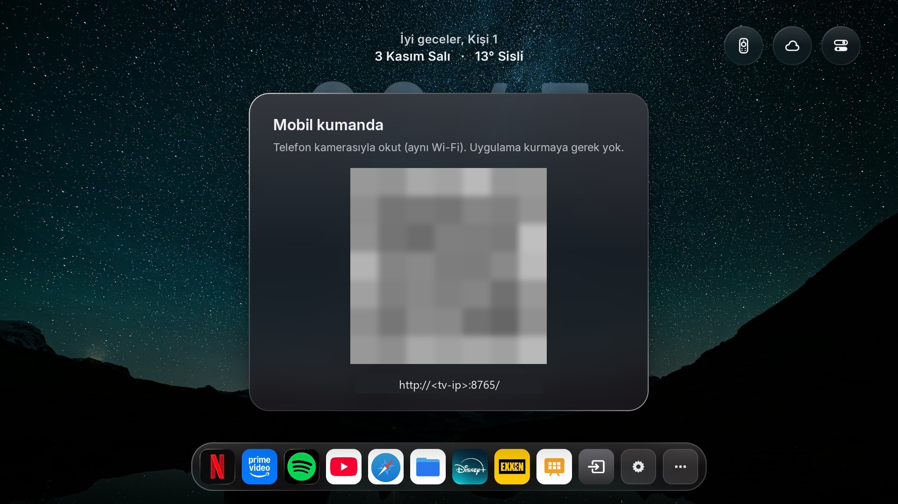
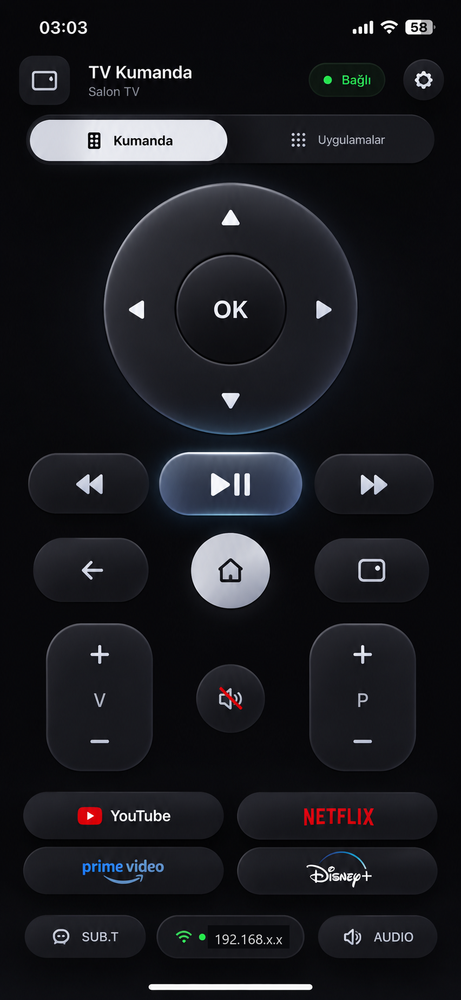
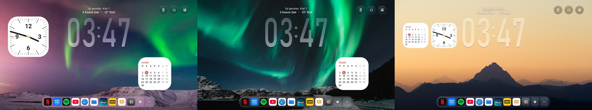
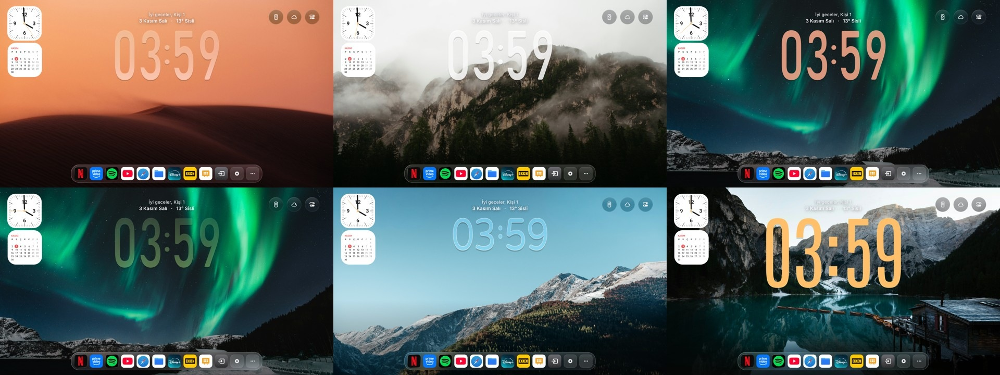
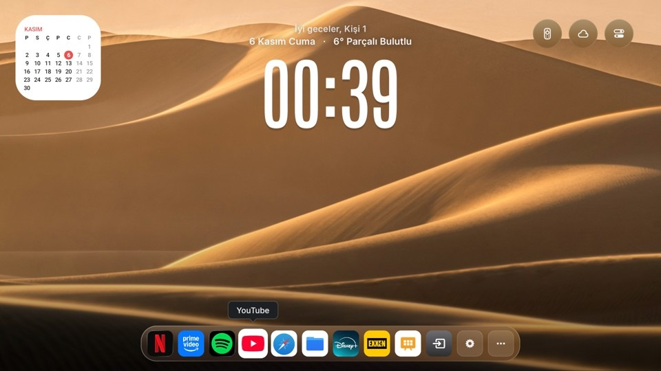

# tvOS Launcher UHD: Apple TV style home screen for Android TV & Google TV

> 🇹🇷 Türkçe: **[README_TR.md](README_TR.md)** · Original project: **[README_UPSTREAM.md](README_UPSTREAM.md)**



A fork of [techgenius1/tvOS-Launcher](https://github.com/techgenius1/tvOS-Launcher) (v2.1.2, Apache-2.0) that turns a
cheap Android TV or Google TV box into an Apple-TV-style TV. It keeps everything upstream has (liquid-glass dock,
night scenes, Continue Watching, debloater) and adds a **phone remote with no app to install**, **home-screen widgets**
(clock, calendar), a **video / fireplace screensaver with a clock**, **4K scenes** and a few quality-of-life fixes.
Built and tested on a 1.8 GB RAM MediaTek TV (Android 14), so it stays light.

Keywords: Android TV launcher, Google TV launcher, tvOS launcher, Apple TV style home screen, liquid glass dock,
Android TV screensaver, fireplace screensaver, phone remote control, TV widgets, 4K wallpapers, Mi Box, Chromecast with Google TV.

## What this fork adds

| Feature | Notes |
|---|---|
| **Phone remote (no app to install)** | The TV runs a small web server (port `8765`). Scan the QR code on the TV with the phone camera, same Wi-Fi. D-pad, OK, back/home, volume, play/pause, app shortcuts, a browser tab and a trackpad. |
| **Home-screen widgets** | Analog clock and month calendar widgets that you place on the home screen (see the picture above). |
| **TV panel on the phone** | Memory and storage at a glance, free memory, sleep timer, screensaver settings and video upload, all in the phone remote (gear → TV Paneli). |
| **Screensaver (DreamService)** | Muted videos in random order or, if there are none, a procedural animated fireplace, with a large clock and date on top. The clock drifts slowly to protect the panel, and the picture dims after midnight. |
| **Edit Home Screen** | A Control Center tile opens a remote-driven editor over the home screen: clock size, weight (down to extra thin), style, position, solid/glass look and opacity; calendar and analog clock widgets on/off, size and position; top-right button size; Continue Watching on/off, content and vertical position (with an outline while you move it). |
| **Remote on the phone's home screen** | The phone remote page has a web app manifest and icon: in Chrome choose "Add to Home screen" to get a "Kumanda" icon. The token stays in the phone's browser storage, the manifest holds none. Plain HTTP on the home network is not a secure origin, so Chrome only adds a shortcut; for a real install, the remote's "Other keys" menu has an "Install as an app" section that copies the `chrome://flags/#unsafely-treat-insecure-origin-as-secure` address and the remote's own address (a web page may not open `chrome://` itself), then shows an Install button once Chrome allows it. |
| **Next wallpaper button** | A round button in the top-right corner skips to the next wallpaper right away. |
| **Wallpaper upload from the phone** | TV Paneli → Duvar kâğıdı yükle saves pictures (jpg, png, webp) to `Pictures/Kumandadan` on the TV, creating the folder if needed. |
| **Smooth return to Home** | Coming back from an app shows the wallpaper, its shade and the clock at once (no black frame, no clock jump). The clock lives in a normal view above the wallpaper surface. |
| **Remote app buttons on Google TV** | YouTube, Netflix and Prime Video buttons keep working; if Google TV's own launcher is disabled the launcher opens the app itself. |
| **Continue Watching, only what you watched** | By default the row shows only what was actually started, not the apps' suggestion rows (switchable in the editor). |
| **Built for low RAM** | Only the wallpaper on screen is kept while another app is in front; everything is freed when the system is really short of memory. Optional low memory mode draws wallpapers at 1080p. |
| **4K scenes** | Night Scenes are rendered on a 4K surface, with prefetching and a background loader. |
| **Liquid-glass transition** | Smooth glass blend when moving between home and the control panel. |
| **Home button recovery** | Takes the Home key back from the stock Google TV launcher, plus accessibility helpers. |
| **YouTube seek then autoplay** | Skipping forward/back in YouTube resumes playback automatically. |
| **Continue Watching on by default** | Upstream v2.1.2 feature, enabled out of the box here. |
| **Auto-update dialog off** | The in-app updater no longer pops up; you can still check manually in Settings. |

### Phone remote

| QR code on the TV | The remote on the phone |
|---|---|
|  |  |

### Wallpapers and widgets





## Screensaver

Set the launcher as the system screensaver (Settings → Device preferences → Screen saver). It uses, in order:

1. Every video in the app's external files folder (`mp4`, `mkv`, `webm`, `mov`, `m4v`), muted and center-cropped to fill
   the screen. One file loops; several play in random order. A file the TV cannot decode is skipped.
2. Otherwise a built-in procedural fireplace (no download needed).

Add videos from the phone remote: gear → **TV Paneli** → **Video yükle**. It also works from a computer browser on the
same Wi-Fi, and the file goes straight to disk, so size is limited only by free storage. Or use adb:

```bash
adb push fireplace.mp4 /sdcard/Android/data/<your.package>/files/
```

Videos are **not** shipped in this repo; Pexels videos are free to use under the
[Pexels license](https://www.pexels.com/license/). A 1080p H.264 file is the safe choice on low-RAM TVs. The same panel
switches between video, drawn fireplace and wallpaper shuffle, and turns the clock, date and night dim on or off.

## Edit Home Screen

Open Control Center (top-right) and choose the sliders tile. A panel opens over the home screen:

- **Up/Down** picks a row, **Left/Right** changes it, **OK** toggles or starts moving a widget (arrows move it, OK or
  Back ends), **Back** closes. Every change is applied and saved at once, per profile.
- Clock: size (30–150%), weight (below "Normal" the digits are thinned), style (Duo, Rounded, Tall), position, solid or
  glass, opacity.
- Widgets: calendar and analog clock on/off, size, position.
- Top-right buttons: size (24–48 dp).
- Continue Watching: on/off, content (only what you started, or the apps' suggestion rows too) and vertical position.
- Reset all, Done.

The same clock settings are also in the phone remote.

## Notes and fixes in this release

- **Much lower system load.** The volume-hold helper polled the audio service dump every 60 ms; it now runs only for a
  few seconds after a volume key. Accessibility and notification-listener component names were built from the package
  name, which is wrong when the app id is renamed (`PKG=`); the system kept removing the invalid entry and the app kept
  writing it back several times a second. On a weak TV this alone froze the device.
- **One home task.** Every internal start of the home screen uses `MAIN` + `HOME`, so Home never creates a second
  MainActivity that has to decode the wallpaper again.
- **Wallpaper crossfade** is completed (not left half-blended) when another app opens mid-fade.
- **Phone remote typing** into web pages no longer piles up letters: the fallback sends only the change and always jumps
  to the newest text.
- **TV vendor quirks seen during testing:** some TVs block background service binding after an update until the
  launcher is opened once; the Home key may never reach accessibility services; app buttons are only delivered while
  Google TV's launcher package is enabled.

## Build

JDK 17+, Android SDK build-tools 34.0.0 and platform android-34. No Gradle.

```bash
./build.sh                                   # -> build/tvos-home.apk (debug-signed)
VERSION_CODE=179 VERSION_NAME=2.1.2-uhd37 PKG=com.example.tvoslauncher ./build.sh
```

`PKG` renames the application id so the build installs next to (or instead of) another build. Updates keep data as
long as the id and signing key stay the same, and `VERSION_CODE` must go up on every build.

## Credits and license

Apache-2.0, same as upstream; see [LICENSE](LICENSE) and [NOTICE](NOTICE). All credit for the launcher itself goes to
[techgenius](https://github.com/techgenius1/tvOS-Launcher) and the projects listed in `NOTICE`. This fork only adds
the features in the table above. Not affiliated with Apple; "tvOS" is a trademark of Apple Inc.
