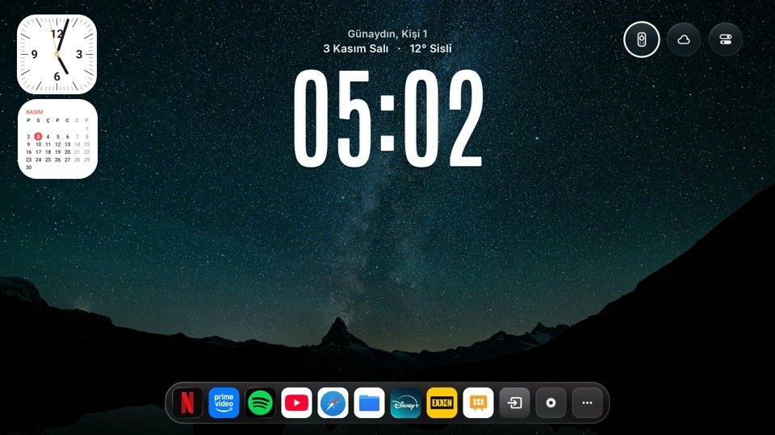
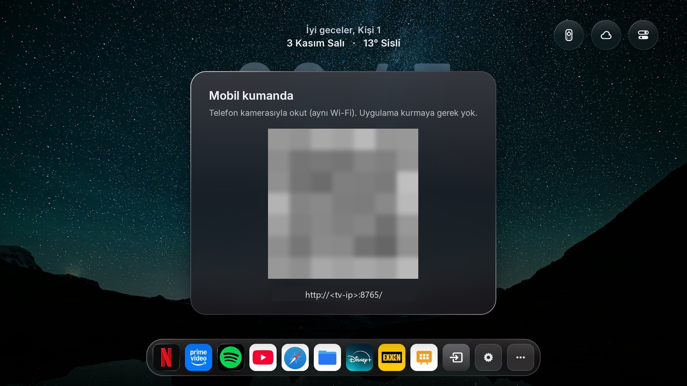
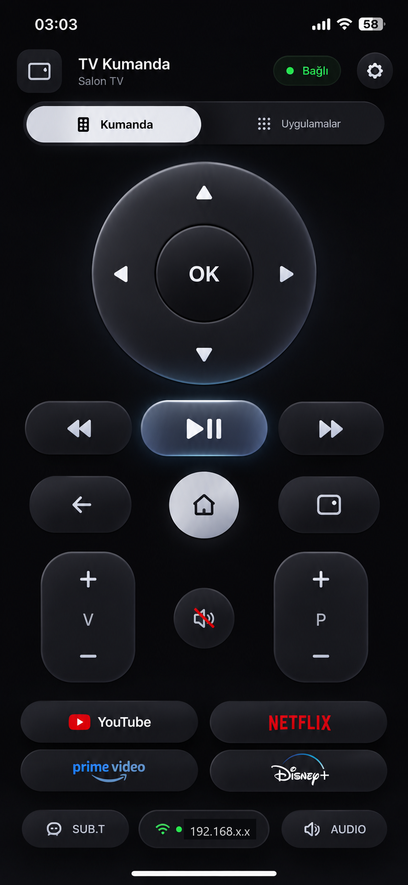
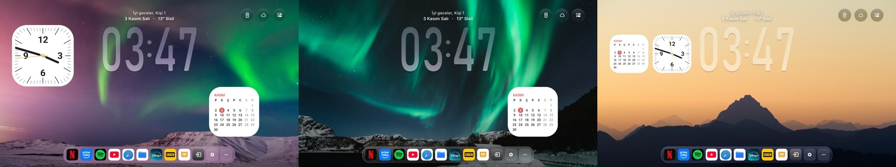
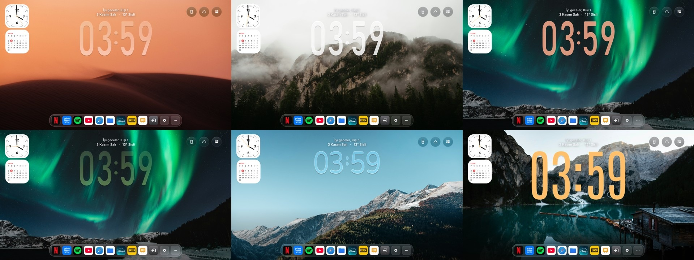
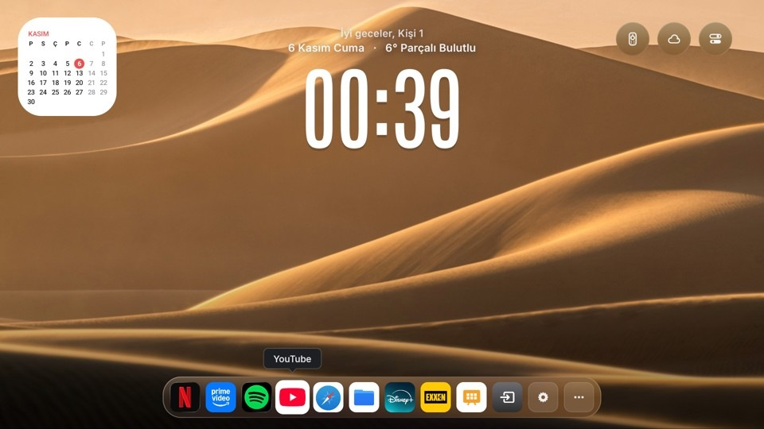

# tvOS Launcher UHD: Android TV ve Google TV için Apple TV tarzı ana ekran

> 🇬🇧 English: **[README.md](README.md)** · Orijinal proje: **[README_UPSTREAM_TR.md](README_UPSTREAM_TR.md)**



[techgenius1/tvOS-Launcher](https://github.com/techgenius1/tvOS-Launcher) (v2.1.2, Apache-2.0) projesinin çatalı.
Ucuz bir Android TV veya Google TV kutusunu Apple TV görünümlü bir TV'ye çevirir. Orijinaldeki her şey durur
(sıvı cam dock, gece sahneleri, İzlemeye Devam Et, debloater); üstüne **uygulama kurmadan telefon kumandası**,
**ana ekran widget'ları** (saat, takvim), **saatli video / şömine ekran koruyucu**, **4K sahneler** ve birkaç
iyileştirme eklenmiştir. 1,8 GB RAM'li, MediaTek, Android 14 bir TV'de geliştirildi ve denendi.

Anahtar kelimeler: Android TV launcher, Google TV launcher, tvOS launcher, Apple TV tarzı ana ekran, ekran koruyucu,
şömine ekran koruyucu, telefon kumandası, TV widget, 4K duvar kâğıdı, Mi Box, Chromecast with Google TV.

## Bu çatalın eklediği özellikler

| Özellik | Açıklama |
|---|---|
| **Telefon kumandası (uygulama gerekmez)** | TV küçük bir web sunucusu (port `8765`) çalıştırır. TV'deki QR kodu aynı Wi-Fi'daki telefon kamerasıyla okutun. Yön tuşları, OK, geri/ana ekran, ses, oynat/duraklat, uygulama kısayolları, tarayıcı ve trackpad sekmeleri. |
| **Ana ekran widget'ları** | Ana ekrana yerleştirilen analog saat ve aylık takvim (yukarıdaki görsele bakın). |
| **Telefonda TV Paneli** | Bellek ve depolama durumu, bellek boşaltma, uyku zamanlayıcı, ekran koruyucu ayarları ve video yükleme; hepsi telefon kumandasında (dişli → TV Paneli). |
| **Ekran koruyucu (DreamService)** | Rastgele sırada sessiz videolar; video yoksa kodla çizilen hareketli şömine. Üstünde büyük saat ve tarih. Paneli korumak için saat yavaşça kayar, gece yarısından sonra görüntü kararır. |
| **Ana ekranı düzenle** | Kontrol merkezindeki bir düğme, ana ekranın üstünde kumandayla kullanılan bir düzenleyici açar: saat boyutu, kalınlığı (çok inceye kadar), stili, konumu, düz/cam görünümü ve saydamlığı; takvim ve analog saat widget'larını açma-kapama, boyut ve konum; sağ üst düğme boyutu; İzlemeye Devam Et açma-kapama, içerik ve dikey konum (taşırken şablon görünür). |
| **Sonraki duvar kâğıdı düğmesi** | Sağ üstteki yuvarlak düğme bir sonraki duvar kâğıdına hemen geçer. |
| **Telefondan duvar kâğıdı yükleme** | TV Paneli → Duvar kâğıdı yükle, resimleri (jpg, png, webp) TV'de `Pictures/Kumandadan` klasörüne kaydeder; klasör yoksa oluşturur. |
| **Ana ekrana akıcı dönüş** | Uygulamadan dönünce duvar kâğıdı, alt koyu geçiş ve saat hemen görünür (siyah kare yok, saat sıçramaz). Saat, duvar kâğıdı yüzeyinin üstündeki normal bir görünümde çizilir. |
| **Google TV kumanda uygulama tuşları** | YouTube, Netflix ve Prime Video tuşları çalışmaya devam eder; Google TV'nin kendi başlatıcısı kapalıysa uygulamayı launcher açar. |
| **İzlemeye Devam Et, yalnızca izledikleriniz** | Varsayılan olarak şerit yalnızca gerçekten başlatılan içerikleri gösterir, uygulamaların öneri satırlarını göstermez (düzenleyiciden değiştirilebilir). |
| **Az RAM için tasarlandı** | Başka uygulama öndeyken yalnızca ekrandaki duvar kâğıdı tutulur; sistem gerçekten bellek sıkıntısı bildirince hepsi boşaltılır. İsteğe bağlı düşük bellek modu duvar kâğıtlarını 1080p çizer. |
| **4K sahneler** | Gece sahneleri 4K yüzeyde çizilir; önceden yükleme ve arka plan yükleyici vardır. |
| **Cam geçişi** | Ana ekran ile kontrol paneli arasında yumuşak cam geçişi. |
| **Home tuşu kurtarma** | Home tuşunu Google TV başlatıcısından geri alır, erişilebilirlik yardımcıları. |
| **YouTube ileri/geri sonrası otomatik oynatma** | Sarma sonrası video kendiliğinden devam eder. |
| **"İzlemeye Devam Et" varsayılan açık** | Orijinal v2.1.2 özelliği, burada hazır açık gelir. |
| **Otomatik güncelleme penceresi kapalı** | Uygulama içi güncelleyici artık kendiliğinden açılmaz; Ayarlar'dan elle denetlenebilir. |

### Telefon kumandası

| TV'deki QR kod | Telefondaki kumanda |
|---|---|
|  |  |

### Duvar kâğıtları ve widget'lar





## Ekran koruyucu

Başlatıcıyı sistem ekran koruyucusu yapın (Ayarlar → Cihaz tercihleri → Ekran koruyucu). Sırasıyla şunu kullanır:

1. Uygulamanın harici dosyalar klasöründeki tüm videolar (`mp4`, `mkv`, `webm`, `mov`, `m4v`): sessiz ve ekranı
   dolduracak şekilde kırpılarak. Tek dosya döngüde, birden çok dosya rastgele sırada oynar. TV'nin çözemediği dosya atlanır.
2. Video yoksa yerleşik kodla çizilen şömine (indirme gerekmez).

Videoyu telefon kumandasından ekleyin: dişli → **TV Paneli** → **Video yükle**. Aynı Wi-Fi'daki bilgisayar tarayıcısından
da çalışır. Dosya doğrudan diske yazılır, boyutu yalnızca boş depolama sınırlar. İsterseniz adb de olur:

```bash
adb push somine.mp4 /sdcard/Android/data/<paket.adiniz>/files/
```

Video bu depoda **yoktur**; Pexels videoları [Pexels lisansı](https://www.pexels.com/license/) ile ücretsiz
kullanılabilir. Az RAM'li TV'lerde 1080p H.264 dosya güvenlidir. Aynı panelden video, çizilen şömine ve duvar kâğıdı
karışımı arasında geçilir; saat, tarih ve gece karartma açılıp kapatılır.

## Ana ekranı düzenle

Kontrol merkezini (sağ üst) açıp kaydırıcı simgeli düğmeyi seçin. Ana ekranın üstünde bir panel açılır:

- **Yukarı/Aşağı** satır seçer, **Sol/Sağ** değiştirir, **OK** açıp kapatır ya da widget taşımayı başlatır (oklar
  taşır, OK veya Geri bitirir), **Geri** kapatır. Her değişiklik anında uygulanır ve profil başına kaydedilir.
- Saat: boyut (%30–150), kalınlık ("Normal"in altında rakamlar inceltilir), stil (Duo, Yuvarlak, Uzun), konum, düz
  veya cam, saydamlık.
- Widget'lar: takvim ve analog saat açma-kapama, boyut, konum.
- Sağ üst düğmeler: boyut (24–48 dp).
- İzlemeye Devam Et: açma-kapama, içerik (yalnızca başladıklarınız ya da uygulamaların öneri satırları da) ve dikey konum.
- Hepsini sıfırla, Bitti.

Aynı saat ayarları telefon kumandasında da var.

## Bu sürümdeki notlar ve düzeltmeler

- **Çok daha düşük sistem yükü.** Ses tuşu basılı tutma yardımcısı, ses servisinin dökümünü her 60 ms'de istiyordu;
  artık yalnızca ses tuşundan sonra birkaç saniye çalışıyor. Erişilebilirlik ve bildirim dinleyicisi bileşen adları
  paket adından kuruluyordu; uygulama kimliği değiştirilince (`PKG=`) bu ad geçersiz oluyor, sistem kaydı silip uygulama
  saniyede birkaç kez yeniden yazıyordu. Zayıf bir TV'de bu tek başına cihazı donduruyordu.
- **Tek ana ekran görevi.** Ana ekranın tüm iç başlatmaları `MAIN` + `HOME` kullanır; Home, duvar kâğıdını yeniden
  çözmesi gereken ikinci bir MainActivity yaratmaz.
- **Duvar kâğıdı geçişi** başka uygulama açılınca yarıda (iki resim üst üste) kalmaz, tamamlanır.
- **Telefondan web sayfalarına yazma** artık harfleri üst üste yığmaz: yedek yöntem yalnızca farkı gönderir ve hep en
  son metne atlar.
- **Test sırasında görülen TV üreticisi davranışları:** bazı TV'ler güncellemeden sonra launcher bir kez açılana kadar
  arka planda servis bağlamayı engeller; Home tuşu erişilebilirlik servislerine hiç ulaşmayabilir; uygulama tuşları
  yalnızca Google TV başlatıcı paketi açıkken iletilir.

## Derleme

JDK 17+, Android SDK build-tools 34.0.0 ve platform android-34. Gradle gerekmez.

```bash
./build.sh                                   # -> build/tvos-home.apk (debug imzalı)
VERSION_CODE=177 VERSION_NAME=2.1.2-uhd35 PKG=com.ornek.tvoslauncher ./build.sh
```

`PKG` uygulama kimliğini değiştirir. Kimlik ve imza anahtarı aynı kaldıkça güncelleme verileri korur; her derlemede
`VERSION_CODE` artmalıdır.

## Lisans

Orijinal gibi Apache-2.0; bkz. [LICENSE](LICENSE) ve [NOTICE](NOTICE). Başlatıcının tüm emeği
[techgenius](https://github.com/techgenius1/tvOS-Launcher) ve `NOTICE` içindeki projelere aittir; bu çatal yalnızca
yukarıdaki tabloyu ekler. Apple ile bağlantısı yoktur; "tvOS" Apple Inc. markasıdır.
